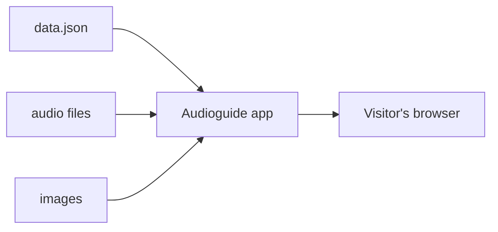

# Content

Everything a visitor sees or hears comes from **one JSON file** and the media it points at. The app itself contains no content.

That separation is the design: the app is a static bundle, the content is data, and either can change without touching the other. The content can live on a host of its own, or be [bundled into the app](./media.md#bundling-the-content-with-the-app) for a single deployment.



## The file at a glance

```js
{
  "checksum": "…",     // changes whenever your content changes
  "languages": [ … ],  // the languages a visitor can pick
  "assets":    [ … ],  // every audio file and image, with its URL
  "stations":  [ … ],  // the points of interest, one entry per language
  "texts":     [ … ],  // interface strings, per language
  "tours":     [ … ],  // optional: groupings of stations
  "pins":      [ … ],  // optional: access codes
  "server":    [ … ],  // optional: local download servers
  "share":     "…"     // optional: URL for the share sheet
}
```

Five keys are required — `checksum`, `languages`, `assets`, `stations`, `texts`. Add the rest when you need them.

## The multilingual model, up front

This is the one thing that surprises people, so it is worth stating plainly:

> **A station is not one object with translations inside it. A station is repeated once per language.**

Three stations in three languages means nine entries in `stations`, sharing their `id` and `number`, each with its own `language`, `title` and `audios`. Images are usually shared between the language variants, because a photograph rarely needs translating. Tours and texts work the same way. [Languages](./languages.md) explains how to keep that manageable.

## Where to start

| Page | What it covers |
| --- | --- |
| [Data format](./data-format.md) | The complete reference for every field |
| [Stations](./stations.md) | Numbers, titles, audio, images, coordinates |
| [Tours](./tours.md) | Grouping stations into routes |
| [Languages](./languages.md) | Offering more than one language |
| [UI texts](./ui-texts.md) | Every interface string the app looks up |
| [Media](./media.md) | Hosting, formats, sizes, and the CORS rule |
| [Access and sharing](./access-and-sharing.md) | PIN codes, share links, local download servers |

## Working examples

Two complete data files, in both schema versions:

| Example | v1.0 | v1.1 |
| --- | --- | --- |
| *Animals* — three stations in German, English and Spanish | [data.json](https://smartcompanion-app.github.io/data-format/v1.0/animals/data.json) | [data.json](https://smartcompanion-app.github.io/data-format/v1.1/animals/data.json) |
| *Leon* — a German-language walk through Bruck an der Großglocknerstraße | [data.json](https://smartcompanion-app.github.io/data-format/v1.0/leon/data.json) | [data.json](https://smartcompanion-app.github.io/data-format/v1.1/leon/data.json) |

Both are short, and worth reading end to end before you write your own.

## Validating your file

The format is specified as a [JSON Schema](https://smartcompanion-app.github.io/data-format/v1.1/schema.json), so any schema validator checks your file. The easiest is your editor: map the schema to your `data.json` and errors show as you type. In VS Code that is the `json.schemas` setting:

```json title=".vscode/settings.json"
{
  "json.schemas": [
    {
      "fileMatch": ["customization/*/data/data.json"],
      "url": "https://smartcompanion-app.github.io/data-format/v1.1/schema.json"
    }
  ]
}
```

:::warning[Do not add `$schema` to the file]

The schema sets `additionalProperties: false`, so a `$schema` key inside `data.json` is itself a validation error. Map the schema in your editor instead.

:::

From the command line, with [`check-jsonschema`](https://github.com/python-jsonschema/check-jsonschema):

```bash
pipx run check-jsonschema \
  --schemafile https://smartcompanion-app.github.io/data-format/v1.1/schema.json \
  data.json
```

A schema check catches shape errors — a missing `title`, a number where a string belongs. It cannot catch a station pointing at an asset id that does not exist; for that, see the [checklist](./data-format.md#checklist).
