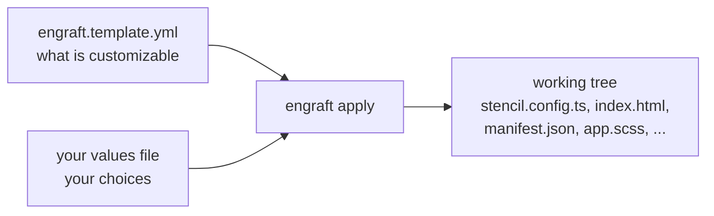

# Customization

The app ships as the *Animals* demo. Turning it into your institution's guide means changing a title, a data URL, two colours, a logo and an icon — in a way that survives pulling updates from upstream.

## The problem with editing files directly

You *can* open `stencil.config.ts` and change `DATA_URL`. It works, and it is the fastest way to see your own content on screen. But every such edit is a change to a file the upstream project also changes, so every update you pull turns into a merge conflict, forever.

## engraft

Customization goes through [**engraft**](https://github.com/smartcompanion-app/engraft), a small tool that applies a declarative customization layer to a working tree.

- The **repository** declares *what can be customized*, in [`engraft.template.yml`](https://github.com/smartcompanion-app/audioguide-app/blob/main/engraft.template.yml).
- **You** declare *your choices*, in a values file such as `customization/my-museum/engraft.variables.yml`.
- `engraft apply` writes your choices into the working tree, in place.

The source stays clean and runnable — there are no `{{ placeholders }}` anywhere — and your customization is one small YAML file plus some images. Upstream never touches those, so merges stay quiet.



## Applying a customization

```bash
npx engraft apply \
  --template engraft.template.yml \
  --values customization/my-museum/engraft.variables.yml
```

engraft is published as `@smartcompanion/engraft` and is already a devDependency of the app, so `npm install` is all the setup there is. Its own documentation is at [smartcompanion-app.github.io/engraft](https://smartcompanion-app.github.io/engraft/).

A ready-made example lives in [`customization/leon/`](https://github.com/smartcompanion-app/audioguide-app/tree/main/customization/leon) — the [Quickstart](../quickstart.md#step-2--brand-it) starts from it.

## What gets rewritten

| File | What changes |
| --- | --- |
| `stencil.config.ts` | Title, data URL, offline and messaging switches |
| `src/index.html` | Page title, description, `theme-color` metas, `lang` attribute |
| `src/manifest.json` | Name, short name, description, language, background and theme colour |
| `src/global/app.scss` | The colour variables |
| `src/assets/logo.png`, `logo-dark.png` | Replaced by your logo files |
| `scripts/generate-icons.mjs` | The icon source image and its background colour |

Each edit is format-aware rather than a blind text substitution: JSON is edited as JSON, HTML through an HTML parser, and source files through a regular expression with a named group.

:::note[engraft rewrites files in place]

After an apply, your working tree is *modified*. That is intentional: you build from it, and `git diff` shows exactly what the customization did. Whether you commit the result is your call — see [Variants](./variants.md#committing-the-result-or-not).

:::

## Read on

| Page | What it covers |
| --- | --- |
| [Variables](./variables.md) | Every variable you can set, and what it affects |
| [Colors](./colors.md) | How two colours become a whole palette, in light and dark mode |
| [Logos and icons](./logos-and-icons.md) | The logo, the dark-mode logo, and the icon set generated from one image |
| [Variants](./variants.md) | Several branded builds in one repository |

## Beyond engraft

engraft covers the customization surface the project supports. Anything past it — a new page, a different menu, a changed route — is a code change in your fork.

That is a legitimate thing to do; it is what a BSD licence is for. Read [Architecture](../reference/architecture.md) first to find out whether the thing you want to change lives in the app or in the [library](../library/index.md), and expect to carry the patch across upstream updates yourself.

If a customization looks generally useful, the better path is a pull request adding it to `engraft.template.yml` — then it is a supported variable rather than a fork you maintain alone.
