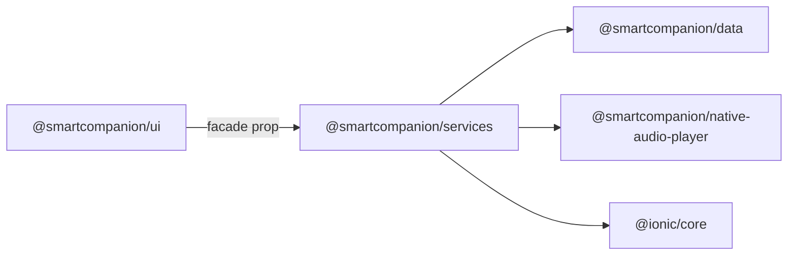

# Library

The SmartCompanion library is the code behind every SmartCompanion app: the data layer, the services that drive it, and the web components visitors see. The [audioguide app](https://github.com/smartcompanion-app/audioguide-app) is a thin shell around it, and so are the venue apps built on it.

This section is for developers — writing an app of their own, routing to pages the default app leaves out, or changing the components themselves. Running a guide with the default app needs none of it; start with the [Quickstart](../quickstart.md) instead.

## The packages

| Package | What it is |
| --- | --- |
| [`@smartcompanion/data`](./data.md) | Domain models and the data layer: stations, tours, assets, languages, texts, PINs; storage, loading and updates |
| [`@smartcompanion/services`](./services.md) | The `ServiceFacade` over the data layer, plus audio playback, the menu and [routing](./routing.md) |
| [`@smartcompanion/ui`](./ui.md) | Stencil web components: five building blocks and thirteen ready-made pages |

The pages in `ui` do not import `services`. Each page declares the slice of the facade it uses as a TypeScript type, and the `ServiceFacade` of `services` satisfies all of them — so an app passes one object to every page, and a test can pass a small stand-in.

## Versions

All three packages are released together and always share one version number. They use semver: a major release can break apps built on them, and its changelog says how to migrate.

| Library | Ionic | Routing |
| --- | --- | --- |
| 2.x | 9 | `ion-router` rendering into `ion-router-outlet` |
| 1.x | 8 | `ion-router` driving `ion-nav` |

The changelogs: [data](https://github.com/smartcompanion-app/smartcompanion-library/blob/main/packages/data/CHANGELOG.md) · [services](https://github.com/smartcompanion-app/smartcompanion-library/blob/main/packages/services/CHANGELOG.md) · [ui](https://github.com/smartcompanion-app/smartcompanion-library/blob/main/packages/ui/CHANGELOG.md).

## Read on

| Page | What it covers |
| --- | --- |
| [Getting started](./getting-started.md) | Installing the packages and wiring up a minimal app |
| [Data](./data.md) | The models, storage, and how content is loaded and updated |
| [Services](./services.md) | The facade, the audio player and the menu |
| [Routing](./routing.md) | Navigating between pages with Ionic 9 |
| [UI components](./ui.md) | The pages and components, their texts, and the map |
| [Development](./development.md) | Working on the library itself |
| [Storybook](pathname:///storybook/) | Every component, live, with its properties and events |
