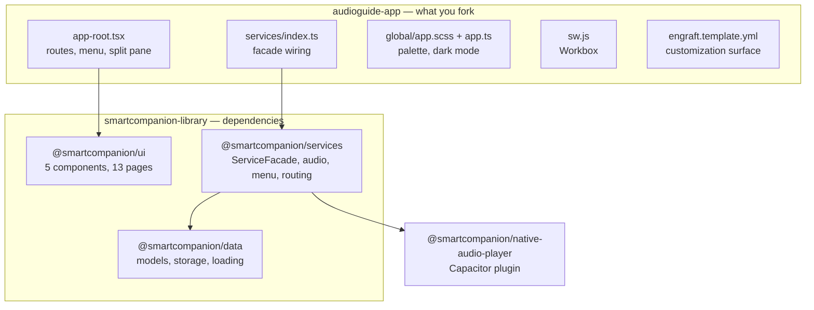

# Architecture

The most useful thing to know before changing anything: **the repository you fork is a shell.** Almost everything a visitor sees lives in a separate library and arrives as an npm dependency.



## Where a change belongs

| You want to change | It lives in |
| --- | --- |
| A route, the menu | `audioguide-app` — `src/components/app-root/app-root.tsx` |
| The colour palette or dark-mode behaviour | `audioguide-app` — `src/global/` |
| The service worker's caching | `audioguide-app` — `src/sw.js` |
| Which services are registered | `audioguide-app` — `src/services/index.ts` |
| What can be customized | `audioguide-app` — `engraft.template.yml` |
| The look of a page, the player, the keypad | `smartcompanion-library` — `packages/ui` |
| Audio, menu or routing behaviour | `smartcompanion-library` — `packages/services` |
| The data model, storage, loading | `smartcompanion-library` — `packages/data` |
| Background playback, lock-screen controls | `native-audio-player` |
| The data format itself | `data-format` |

If your change is to a page or a service, it belongs in the library — see [Library](../library/index.md). If it is to the app shell, the build, the customization surface or the deployment, it belongs in the app.

## The app repository

```
src/
├─ components/app-root/    # the one Stencil component of the app
│  ├─ app-root.tsx         # routes, menu, navigation
│  └─ app-root.css
├─ global/
│  ├─ app.ts               # dark mode, theme-color sync
│  ├─ app.scss             # palette: light on :root, dark on :root.ion-palette-dark
│  └─ _color-helpers.scss  # the colour derivation functions
├─ services/index.ts       # ServiceFacade construction and registration
├─ assets/                 # logo and logo-dark — everything here is published
├─ icon.png                # the source image of the icon set
├─ index.ts                # entry point: imports Ionic and @smartcompanion/ui
├─ index.html              # the HTML shell
├─ manifest.json           # PWA manifest
└─ sw.js                   # Workbox service worker
scripts/generate-icons.mjs # derives the icon set, run before every build
stencil.config.ts          # build configuration and runtime values
engraft.template.yml       # the customization surface
customization/             # values files, branding and content, one folder per variant
www/                       # build output, git-ignored
```

The app defines **one** Stencil component, `app-root`. Every page comes from `@smartcompanion/ui`.

## Routing

Ionic's router, hash-based, rendering each page into an `ion-router-outlet`:

```tsx title="src/components/app-root/app-root.tsx"
<ion-router useHash={true}>
  <ion-route url="/" component="sc-page-loading" componentProps={{ facade: serviceFacade, image: 'assets/logo.png', imageDark: 'assets/logo-dark.png' }} />
  <ion-route url="/language" component="sc-page-language" componentProps={{ facade: serviceFacade }} />
  <ion-route url="/selection" component="sc-page-selection" componentProps={{ facade: serviceFacade }} beforeEnter={() => serviceFacade.canLoadRoute()} />
  <ion-route url="/stations/:stationId" component="sc-page-stations" componentProps={{ facade: serviceFacade }} beforeEnter={() => serviceFacade.canLoadRoute()} />
  <ion-route url="/pin" component="sc-page-pin" componentProps={{ facade: serviceFacade }} beforeEnter={() => serviceFacade.getLanguageService().hasLanguage() || { redirect: '/' }} />
  <ion-route url="/error" component="sc-page-error" componentProps={{ facade: serviceFacade }} />
</ion-router>

<ion-split-pane when="md" content-id="main">
  <ion-menu contentId="main">…</ion-menu>
  <ion-router-outlet swipeGesture={false} id="main" />
</ion-split-pane>
```

Hash-based URLs are what make the app deployable to any static host without rewrite rules.

`canLoadRoute()` is the guard: when the content is not loaded yet, it remembers the requested route and redirects to `/`; the loading page continues to the remembered route once it is done. The stack of pages is the browser's history — [Routing](../library/routing.md) explains `push()`, `replace()` and `back()`.

The app listens to every route change to refresh the menu labels, which is how a language change reaches the menu.

## The service facade

One object coordinates everything:

```ts title="src/services/index.ts"
const serviceFacade = new ServiceFacade();
serviceFacade.registerCollectibleAudioPlayerService(Env.TITLE);
serviceFacade.registerOnlineLoadService(() => fetch(Env.DATA_URL, { cache: 'no-store' }).then(response => response.json()));
export { serviceFacade };
```

Registering an audio player and a load service is required; the rest — the domain services, routing, the menu — the facade creates on first use. Pages take the facade as their `facade` property, passed through `componentProps` on each route. [Services](../library/services.md) describes the whole facade.

## Data loading

Two registrations, one chosen at build time by `OFFLINE_SUPPORT`:

**Online:**

```ts
serviceFacade.registerOnlineLoadService(() => fetch(Env.DATA_URL, { cache: 'no-store' }).then(response => response.json()));
```

**Offline:**

```ts
serviceFacade.registerOfflineLoadService(
  () => fetch(Env.DATA_URL).then(/* … */),             // the data file
  (url) => isServiceWorkerReady().then(/* fetch */),   // each asset
  () => Promise.resolve(),                             // remove, save, list: the
  () => Promise.resolve(),                             // service worker's cache does
  () => Promise.resolve([]),                           // the storing on the web
);
```

On the web, fetching an asset is enough — the service worker caches it. A native app passes callbacks that write to the device's file system instead. See [Offline](../features/offline.md).

## State

Stencil `@State()` for the menu's reactive state: the four menu labels and whether to show the language and the share item.

Visitor state that outlives a page load — the chosen language, the loaded content, listening progress, the PIN — is kept in the device's local storage by `@smartcompanion/data`.

## Styling

Colour tokens are defined twice in `src/global/app.scss`: light values on `:root`, dark overrides on `:root.ion-palette-dark`. The `--sc-*` properties are mapped onto Ionic's `--ion-color-*`, so Ionic components pick up the palette. `_color-helpers.scss` holds the derivation functions; see [Colors](../customization/colors.md).

Dark mode uses Ionic's class-based palette, toggled by `src/global/app.ts`.

## Build

Stencil, configured in `stencil.config.ts` — see [Configuration](./configuration.md). Before every build and dev start, `scripts/generate-icons.mjs` generates the icon set from one source image. The output in `www/` is static files only.

## Conventions

| | |
| --- | --- |
| Component tags | kebab-case — `app-root`, `sc-page-stations` |
| Classes | PascalCase |
| Functions and variables | camelCase |
| CSS custom properties | `--sc-` prefix, kebab-case |
| Async | `async`/`await` throughout |
| JSX | Stencil's `h` factory, not React's |
| Formatting | Prettier — 180-character lines, single quotes, two-space indent, LF |

Two rules the shell follows and a fork should keep:

- **Close the menu before navigating** — `await serviceFacade.getMenuService().close()`
- **Check the current hash before navigating**, so tapping the overview while already on the stations does not reload the page
